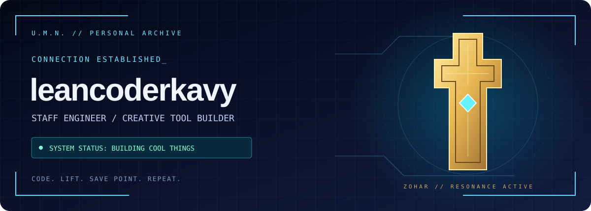

<p align="center">
  
</p>

<p align="center">
  <b>Welcome to my little corner of the U.M.N.</b><br/>
  Staff software engineer. Creative tooling enthusiast. Side-quest enjoyer.
</p>

<p align="center">
  
  
  
</p>

## ✦ Mission log

I build tools that connect AI assistants to creative workflows, make developer life more fun, and occasionally give the terminal an anime arc.

```text
╭─ VECTOR // ENGINEER DOSSIER ─────────────────────────╮
│ Main quest    Build useful things with personality. │
│ Side quest    Olympic weightlifting.                │
│ Fuel source   Plants.                               │
│ Battle theme  Xenosaga energy, always.               │
│ Save point    git commit                           │
╰────────────────────────────────────────────────────╯
```

## ⌘ Equipped systems

| System | Mission |
| :--- | :--- |
| **[Premiere Pro MCP](https://github.com/leancoderkavy/premiere-pro-mcp)** | Connect AI assistants to Adobe Premiere Pro through a local CEP bridge. |
| **[Avid Media Composer MCP](https://github.com/leancoderkavy/avid-media-composer-mcp)** | Explore editing projects and media with guarded creative workflow automation. |
| **[Waifu Usage Monitor](https://github.com/leancoderkavy/waifu-usage-monitor)** | Keep AI usage limits in sight—with an anime companion along for the ride. |
| **[Anime TTS](https://github.com/leancoderkavy/anime-tts)** | Give Claude Code an anime voice and terminal effects. Because why shouldn't your tools have a character arc? |

## ◇ Ether loadout

<p>
  
  
  
  
</p>

<details>
<summary><b>▸ Open the optional boss encounter</b></summary>

<br/>

```text
GNOSIS DETECTED: a bug that only happens in production.

> equip debugger
> cast reproducible_example
> reload last save

KOS-MOS would probably have fixed it already.
```

</details>

---

<p align="center">
  <b>“One more commit” is my “one more battle.”</b><br/>
  <sub>Original fan-made visual inspired by Xenosaga. No official affiliation.</sub>
</p>
